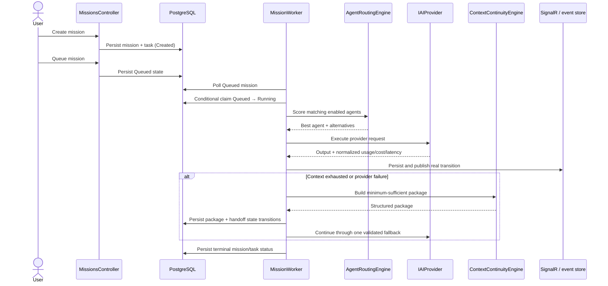

# Architecture

NEURA is an ASP.NET Core MVC modular monolith. Razor Views are the primary
UI; Cytoscape.js and SignalR enhance the Brain screen without replacing MVC.
Module boundaries are source/project boundaries in one deployable host,
not microservices.

## Module map

| Module | Responsibility | Current boundary |
|---|---|---|
| AgentManagement | Agent definitions, capability and status model | Domain project; EF persistence in Infrastructure |
| ProviderIntegration | `IAIProvider`, OpenAI/Anthropic/Google adapters, simulation adapter, pricing, resilience | Provider-independent contract in module; keys resolved via factory |
| Orchestration | Mission/task domain, routing score, context continuity, task execution events | Runs from a database-backed hosted worker |
| ContextManagement | Handoff package, trust-labeled reference data, context thresholds | Package and trust contracts |
| Handoff | Handoff state/reason and receiver validation | Lifecycle records are persisted through `IHandoffSink` |
| Memory | Five memory types and project associations | Domain + EF model; safe owner-scoped inspection/search UI |
| KnowledgeGraph | Project nodes/edges | Domain + EF model; interactive Cytoscape view |
| Execution | `IExecutionSandbox` and Docker-backed implementation | Explicit Admin action only; not automatically invoked from AI output |
| Observability | Audit logs, execution events, notifications, cost records | EF sinks, structured logs, OpenTelemetry HTTP tracing and bounded-cardinality provider/event metrics |
| Infrastructure | EF Core/PostgreSQL, Identity stores, Data Protection, persistence sinks | Single `NeuraDbContext` for the modular monolith |
| Web | MVC, Razor, auth, middleware, worker, SignalR, static CSS/JS | Primary application host |

## Mission execution path

## Work queue and concurrency

`MissionsController` persists `MissionStatus.Queued`; the queue is not an
in-memory channel. `MissionWorker` polls pending IDs and claims each with a
conditional database update (`WHERE Id = ... AND Status = Queued`). On
PostgreSQL this compare-and-set permits only one worker instance to claim a
mission. The EF InMemory integration-test provider uses a tracked-entity
fallback.

This makes queued work durable across process restarts and prevents two
workers from starting the same queued row. While provider work is active,
`MissionRecoveryService` refreshes `UpdatedAtUtc` as a heartbeat. A bounded
recovery sweep conditionally marks a `Running` mission stale after the
configured timeout (default five minutes), closes its nonterminal tasks and
handoffs, and emits `MissionFailed`. A separate `MissionRecoveryWorker` runs
the sweep independently so long provider calls do not block stale cleanup.
Graceful host cancellation is persisted as `Cancelled` when storage is
available.

Recovery is deliberately terminal, not a lease-based resume: it never
re-queues or repeats provider work because the worker may have completed an
external side effect before crashing. Relational recovery updates are
compare-and-set operations in a transaction. Configure
`Neura:MissionRecovery:HeartbeatIntervalSeconds`,
`Neura:MissionRecovery:StaleRunningTimeoutSeconds`,
`Neura:MissionRecovery:RecoverySweepIntervalSeconds`, and
`Neura:MissionRecovery:MaxMissionsPerSweep`. The timeout is normalized to at
least three heartbeat intervals. This protects against stuck `Running` rows,
but does not provide exactly-once provider execution or checkpointed resume.

## Realtime events and ownership

`INeuralEventPublisher` is the application boundary. Its Web implementation
writes `ExecutionEvent` rows and sends `NeuralEvent` over SignalR. Hub
connections are authenticated and receive events only from their server-
derived user group. Admin/Auditor users also receive the explicit
operations group. Event payloads carry mission, task, agent, and owner IDs
where applicable; the UI uses text-only rendering for all event content.

## Scaling direction

At larger scale, keep the same contracts while extracting:

- Orchestration + ProviderIntegration into a worker service consuming a
  durable message/outbox queue.
- ContextManagement/Memory and KnowledgeGraph into data services with
  versioned APIs/events.
- Persisting event delivery onto an outbox or message bus, retaining
  SignalR as the browser transport.
- Identity/Data Protection state into shared stores; rate-limit counters
  already use atomic Redis keys when the shared Redis endpoint is configured.

Do not split these modules into microservices until independent scaling,
release, or ownership requirements justify the operational cost.
